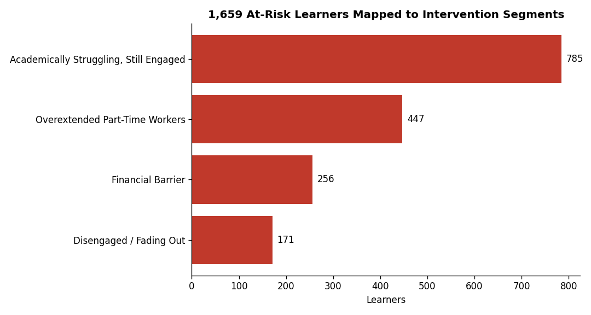
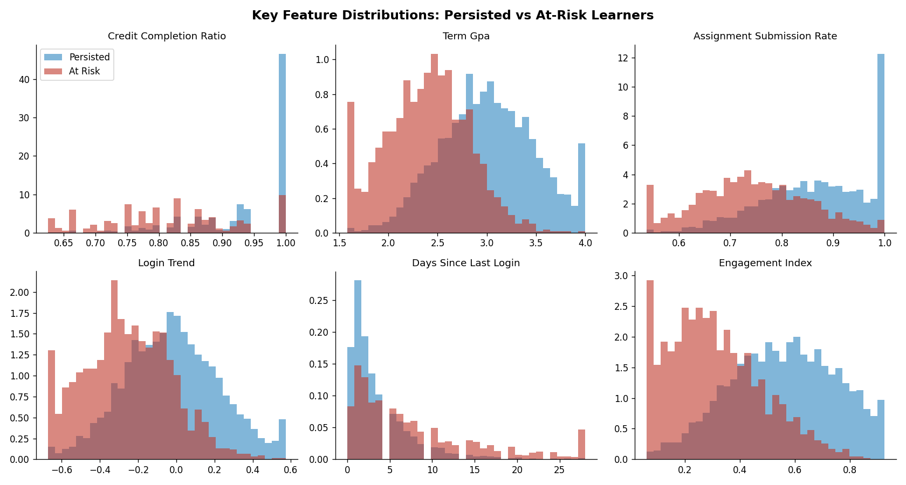
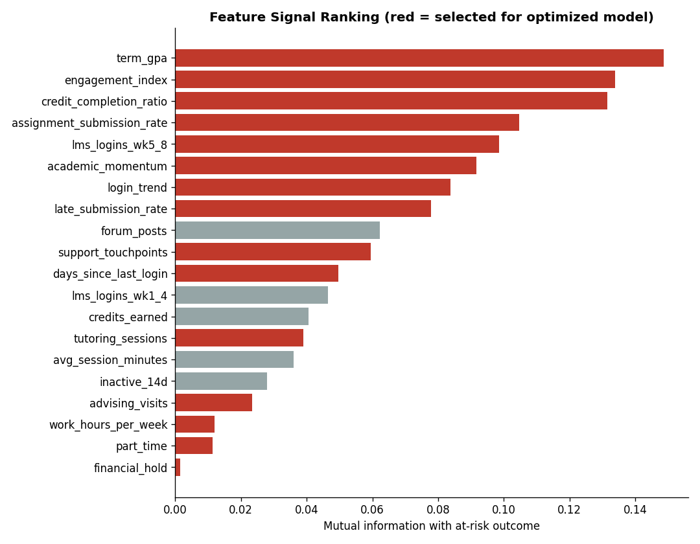
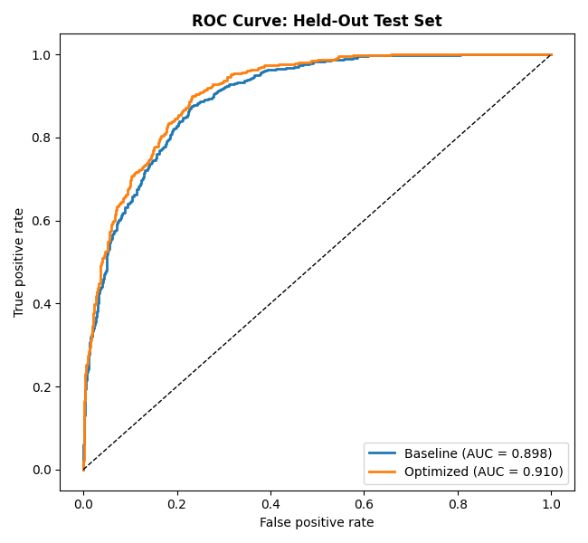
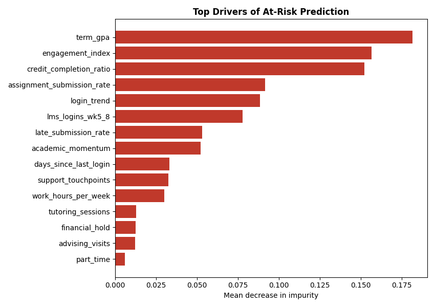
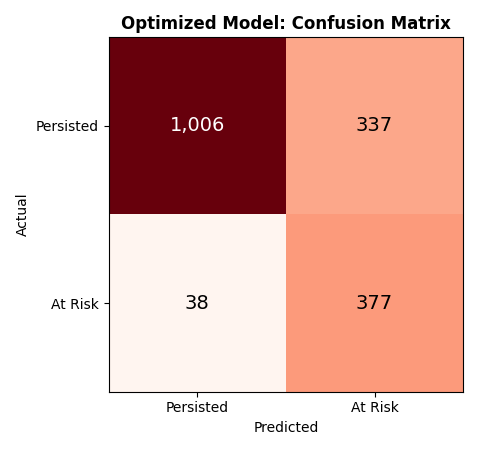
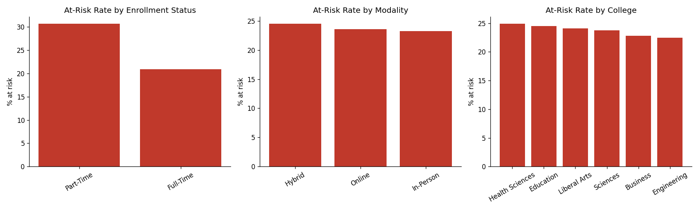

# Student Persistence & At-Risk Analytics

**Python | SQL (SQLite) | scikit-learn | Tableau | Plotly**

An end-to-end early-warning analytics project that predicts which learners are at risk of not persisting to the next term, explains why, and groups at-risk learners into segments that student success teams can act on.



## Business Problem

Student success teams have limited advising capacity. They need to know **who** is likely to leave, **why**, and **which intervention** fits each group, early enough in the term to act.

## Key Results

| Metric | Result |
|---|---|
| Learner records analyzed | **7,032** |
| At-risk learners mapped to segments | **1,659** |
| Random Forest accuracy (held-out test set) | **78.7%** |
| ROC AUC | **0.91** |
| Recall on at-risk learners | **90.8%** |
| Precision lift from EDA feature optimization | **+2.8 pts** (50.0% to 52.8%) with 37 raw fields reduced to 18 engineered features |

The model is tuned for an early-warning use case: the decision threshold is set on out-of-fold training predictions to catch at least 90% of at-risk learners, then evaluated once on a held-out 25% test set.

## At-Risk Segments and Recommended Interventions

| Segment | Learners | Share | Profile | Intervention |
|---|---|---|---|---|
| Academically Struggling, Still Engaged | 785 | 47.3% | Low GPA and credit completion, still logging in | Tutoring referral, instructor early alert, academic recovery plan |
| Overextended Part-Time Workers | 447 | 26.9% | Part-time, about 25 work hours per week | Flexible scheduling, online sections, time management coaching |
| Financial Barrier | 256 | 15.4% | Every learner has a financial hold | Aid counseling, emergency grant screening, hold resolution |
| Disengaged / Fading Out | 171 | 10.3% | 27+ days since last LMS login, falling activity | Outreach within 48 hours of 7+ days inactivity, peer mentor |

## Visuals

| Feature distributions | Feature signal ranking |
|---|---|
|  |  |

| ROC curve | Top drivers |
|---|---|
|  |  |

| Confusion matrix | At-risk rate by group |
|---|---|
|  |  |

An interactive dashboard is generated at `reports/dashboard.html` (download it and open in any browser). Tableau-ready extracts are in `tableau/`, with a step-by-step build guide in [`tableau/TABLEAU_GUIDE.md`](tableau/TABLEAU_GUIDE.md).

## Methodology

1. **Data** (`src/generate_data.py`): 7,032 learner records mirroring a student information system joined with LMS logs: demographics, enrollment, academic progress, engagement (logins in weeks 1 to 4 vs 5 to 8, submissions, inactivity), support usage and financial holds. 1,659 learners did not persist.
2. **SQL** (`sql/`): records loaded into a SQLite database; 8 analysis queries cover persistence by college, enrollment and modality, first-gen and Pell status, engagement by outcome, inactivity bands, financial holds and support usage.
3. **EDA** (`src/eda.py`): distributions by outcome, correlation and mutual information ranking. EDA drove the engineered features: credit completion ratio, login trend (early vs late term), engagement index, academic momentum (term GPA vs high school GPA) and support touchpoints. Low-signal operational fields (zip prefix, parking permit, email open rate, distance) were dropped.
4. **Modeling** (`src/train_model.py`): Random Forest (500 trees, balanced class weights). Baseline on all 37 raw fields vs optimized on 18 EDA features, compared at the same recall target.
5. **Segmentation** (`src/segment.py`): every learner receives an out-of-fold risk score and tier (High, Elevated, Moderate, Low). The 1,659 at-risk learners are clustered with K-Means on behavior, engagement and demographic factors; clusters are named by their centroid profile and paired with an intervention.
6. **Reporting** (`src/export_tableau.py`, `src/build_dashboard.py`): Tableau extracts plus a standalone Plotly dashboard.

## Project Structure

```
student-persistence-analytics/
|-- main.py                     Runs the full pipeline
|-- requirements.txt
|-- sql/
|   |-- schema.sql
|   |-- analysis_queries.sql
|-- src/
|   |-- config.py
|   |-- generate_data.py
|   |-- load_database.py
|   |-- features.py
|   |-- eda.py
|   |-- train_model.py
|   |-- segment.py
|   |-- predict.py              Score new learners with the saved model
|   |-- export_tableau.py
|   |-- build_dashboard.py
|-- data/
|   |-- raw/learner_records.csv
|   |-- processed/              SQL outputs, scored learners, segment profiles
|-- models/                     Saved model (created when you run the pipeline)
|-- reports/
|   |-- dashboard.html
|   |-- model_comparison.csv
|   |-- model_metrics.json
|   |-- feature_importance.csv
|   |-- figures/
|-- tableau/
    |-- TABLEAU_GUIDE.md
    |-- learner_risk_scores.csv
    |-- segment_profiles.csv
    |-- risk_by_demographic.csv
    |-- feature_importance.csv
    |-- inactivity_bands.csv
    |-- model_comparison.csv
```

## How to Run (Windows CMD)

```cmd
cd student-persistence-analytics
python -m venv venv
venv\Scripts\activate
pip install -r requirements.txt
python main.py
start reports\dashboard.html
```

Run a single step, for example only retraining the model:

```cmd
python src\train_model.py
```

Score new learners (same columns as `data/raw/learner_records.csv`):

```cmd
python src\predict.py data\raw\learner_records.csv
```

The full pipeline takes about 2 to 4 minutes. All randomness is seeded, so results reproduce exactly.

## Data Note

The dataset is synthetic, generated to reflect realistic relationships found in student retention research (credit completion, GPA, LMS engagement decline, financial holds, part-time work load). No real student data is used. To run the pipeline on real data, replace `data/raw/learner_records.csv` with a file that has the same columns and run `python main.py --skip-generate`.

## Tech Stack

Python (pandas, NumPy, scikit-learn, SciPy, Matplotlib, Plotly), SQL (SQLite), Tableau.
